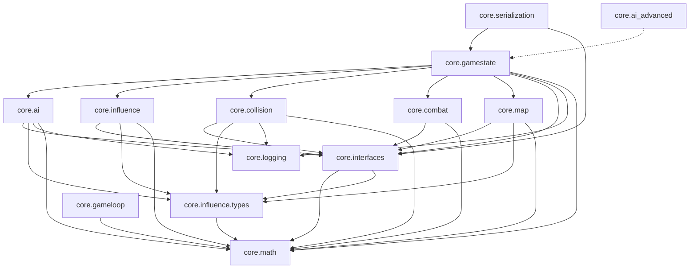

# CoreEngine

A C++17 simulation core for 2D RTS-style games: units, steering AI, collision, a fixed-timestep loop, and a flat C API for other languages. `core/` contains no platform headers, so you can compile it into your own game, Unreal or Unity (through the C API), or run it headless on a server. An optional SDL2 viewer lets you watch and poke the simulation.

```
core/        engine modules (pure C++17 + STL; no SDL/Raylib/UE/Unity headers)
platform/    adapter headers (sdl2, raylib, null, unreal, unity) implementing core interfaces
ffi/         flat C API (c_api.h) + Python / Lua binding examples
tools/       optional SDL2 viewer under tools/viewer/ (off by default)
scripts/     module manifest checks, per-module test runners, FFI verify
tests/       GoogleTest unit and integration tests (BUILD_TESTS=ON)
docs/        architecture, porting, FFI, viewer, agentic workflow, dependency map
```

Deeper reading: [Architecture](docs/ARCHITECTURE.md) · [Porting guide](docs/PORTING_GUIDE.md) · [FFI guide](docs/FFI_GUIDE.md) · [Viewer](docs/VIEWER.md) · [Coding guidelines](docs/CODING_GUIDELINES.md) · [Game seeds integration](docs/GAME_SEEDS_INTEGRATION.md)

---

## What it implements

| Module | Path | What it gives you |
|--------|------|-------------------|
| `core.math` | [core/math](core/math/MODULE.md) | `Vector2`, `Vector3`, math constants, seeded `DeterministicRNG` for replays |
| `core.influence.types` | [core/influence_types](core/influence_types/MODULE.md) | `InfluenceFieldItem` (attractor / repulsor / edge) and its parameter structs |
| `core.influence` | [core/influence](core/influence/MODULE.md) | APF force sum (`InfluenceField::CalculateTotalForce`) and `TerritoryCalculator` (ownership %) |
| `core.ai` | [core/ai](core/ai/MODULE.md) | `StateMachine`, `BehaviorFactory` (create behaviors by name), behaviors Seek / Flee / Wander / Cohesion / Separation, conditions EnemyInRange / AlliesNearby / TimeElapsed |
| `core.collision` | [core/collision](core/collision/MODULE.md) | `SpatialGrid` broadphase, circle narrowphase, impulse resolution, position correction, map edges, collision events, immunity |
| `core.combat` | [core/combat](core/combat/MODULE.md) | `SelectionSystem` (click/box), `CommandSystem` (move-to, state/param overrides), `Explosion` impulses; `CombatManager` is an empty stub |
| `core.gameloop` | [core/gameloop](core/gameloop/MODULE.md) | `GameLogicEngine` fixed timestep (default 1/30 s) with pause, speed, fast-forward; `PlaybackController`, `DeploymentTimer`, `ThinkTimer`, `MatchState` |
| `core.map` | [core/map](core/map/MODULE.md) | `Map` with entities + components (obstacles, resources), `PlacementValidator`, `GameMode` |
| `core.gamestate` | [core/gamestate](core/gamestate/MODULE.md) | `RTSGameState`, the simulation hub (units, map, AI tick, collision, explosions, RNG), `RTSUnit`, `GameStateManager` |
| `core.serialization` | [core/serialization](core/serialization/MODULE.md) | `GameStateSerializer`: JSON snapshot of the state (format `CoreEngine-JSON-v1`) |
| `core.logging` | [core/logging](core/logging/MODULE.md) | Singleton `VenusWars::Logging::Logger` with levels, optional file output, `LOG_DEBUG…LOG_FATAL` macros |
| `core.interfaces` | [core/interfaces](core/interfaces/MODULE.md) | The abstract contracts (next section); header-only |
| `core.ai_advanced` | `core/ai_advanced/` | Experimental: `Genome`, `BotPlayer`, `GeneticTrainer` (no MODULE.md, includes not enforced) |



## Interfaces

All of these live in [`core/interfaces/`](core/interfaces/MODULE.md). Include them from the repo root, e.g. `#include "core/interfaces/IGameUnit.h"`.

| Interface | Purpose |
|-----------|---------|
| `IGameUnit` | The unit contract: `Update`, position/velocity, `ApplyAcceleration`, team, radius, max speed, HP, mass, collision tuning, optional selection/debug |
| `IUnitKinematics` | Optional direct `SetPosition` / `SetVelocity`; collision only writes through this |
| `IUnitAgent` | Optional `SetAgentState` / `SetAgentParameter`; how `CommandSystem` drives a unit without knowing `RTSUnit` |
| `IUnitBehaviorHost` | Optional `GetCurrentBehavior()`; the hub only runs AI on units that implement it |
| `IBehavior` | A steering behavior: `GenerateFieldItems` (preferred) or `CalculateAcceleration`, `OnEnter/OnExit`, name, tunable parameter map |
| `ITransitionCondition` | `Evaluate(BehaviorContext)` → bool, for FSM edges |
| `ISimulationSnapshot` | Read-only map size + unit list (implemented by `RTSGameState`, consumed by the serializer) |
| `IGameLogicRenderer` | Read-only renderer contract: `GetCurrentGameState()`, optional `GetSimulationSnapshot()` (defaults to `nullptr`) |
| `IInputReader` | Platform input: `PollEvents`, mouse, keyboard, optional gamepad |
| `ISerializer` | Byte/string serialize + deserialize, format name, version |
| `IGameState` | App-level state (menu, mission…): `OnEnter/OnExit/Update/Render`, managed by `GameStateManager` |
| `IMapComponent` | Base for map entity components |

`RTSUnit` implements `IGameUnit`, `IUnitKinematics`, `IUnitAgent` and `IUnitBehaviorHost`. To make your own unit type, either derive from `RTSUnit` or implement the interfaces you need.

**Versioning and boundaries:**

- Every module has a SemVer manifest in [docs/agentic/modules/](docs/agentic/modules/registry.json), with patch/minor/major rules in [AGENTS.md](AGENTS.md).
- `core.interfaces` (currently 1.5.0) also keeps a [CHANGELOG](core/interfaces/CHANGELOG.md).
- The manifest `requires` graph is generated into [docs/deps/SUMMARY.md](docs/deps/SUMMARY.md). It is layered foundation → contracts → systems → integration, and must stay acyclic ([policy](docs/agentic/DEPENDENCY_POLICY.md)).
- `./scripts/check-module-deps.sh` checks that `#include`s stay within each module's declared `requires`. This applies to every module except `core.ai_advanced`.
- `core/` may never include `platform/` or `ffi/`.

## Integrating into a game

### Build options

| CMake option (all default `OFF`) | Produces |
|----------------------------------|----------|
| *(none)* | `coreengine` static library (include root = repo root) |
| `BUILD_TESTS` | `coreengine_tests` (GoogleTest, registered with ctest) |
| `BUILD_FFI` | `coreengine_ffi` shared library (`libcoreengine_ffi.so` / `.dylib` / `coreengine_ffi.dll`) |
| `BUILD_SDL2` / `BUILD_RAYLIB` | **Do not use today:** configure **fails** (`No SOURCES given to target`) because only header stubs exist in-repo (`Render()` unimplemented). Add `platform/sdl2/*.cpp` or `platform/raylib/*.cpp` first, then enable. |
| `COREENGINE_BUILD_SDL2_VIEWER` | Runnable SDL2 window/tools (`coreengine_sdl2_viewer` + tests; needs `libsdl2-dev`) |
| `COREENGINE_<MODULE>_STANDALONE` | Builds and tests just one module (can't be combined with the viewer) |

When vendoring this tree as a submodule, use `add_subdirectory(CoreEngine)` and `target_link_libraries(mygame PRIVATE coreengine)` with the include root at the submodule path.

### Minimal loop (C++)

```cpp
#include "core/ai/BehaviorFactory.h"
#include "core/ai/Behaviors/SeekBehavior.h"
#include "core/gameloop/GameLogicEngine.h"
#include "core/gamestate/RTSGameState.h"
#include "core/gamestate/RTSUnit.h"
#include "core/influence_types/InfluenceFieldItem.h"
#include "core/serialization/GameStateSerializer.h"

BehaviorFactory::RegisterBuiltins();

RTSGameState state(Vector2(800.0f, 600.0f), /*rngSeed=*/1);        // any seed is replay-deterministic (incl. 0)
state.AddStaticAttractor(InfluenceFieldItem::CreateAttractor(Vector2(700.0f, 300.0f), 5.0f));

auto unit = std::make_unique<RTSUnit>(Vector2(120.0f, 300.0f), /*team=*/1);
unit->GetStateMachine().AddState("Seek", std::make_unique<SeekBehavior>(Vector2(700.0f, 300.0f)));
state.AddUnit(std::move(unit));                                     // first AddState becomes current

GameLogicEngine logic(1.0f / 30.0f);                                // fixed logic step
logic.SetUpdateCallback([&](float dt) { state.Update(dt); });

while (running) {
    logic.Update(frameDeltaSeconds);                                // accumulates, fires fixed ticks
    for (const IGameUnit* u : state.GetAllUnits())                  // render read-only
        draw(u->GetPosition(), u->GetRadius(), u->GetTeam());
}
std::string json = GameStateSerializer(&state).GetStateJSON();
```

Things that will surprise you (also [VIEWER.md](docs/VIEWER.md#known-limitations)):

- **Built-in steering behaviors use `CalculateAcceleration` when they emit no field items**; map-edge static forces are applied afterward (at map center, edges contribute ~0). For influence-only movement, attach field items via `GenerateFieldItems` or add static attractors as in the snippet below.
- **Automatic FSM transitions don't fire.** The hub never calls `StateMachine::Update`. Switch states with `SetState` or `CommandSystem`, or call `StateMachine::Update(ctx)` yourself, as the UE5 example in the porting guide does.
- **Collisions don't cost HP**, and `GameStateSerializer::DeserializeFromString` always returns `false`, so saving works but loading doesn't yet.

### Other languages and engines: C FFI

[`ffi/c_api.h`](ffi/c_api.h) is the only cross-language boundary. It uses opaque handles, POD structs, and plain `int` status returns (`1`/`0` for most calls; buffer functions return `-1` on error). Call it from one thread unless you add your own locking.

```c
CE_Engine e = ce_engine_create(1600.0f, 900.0f, 42);  /* LCG seed; 0 is valid and deterministic */
while (!ce_timer_has_charge(e, 1))                    /* spawns cost a deployment    */
    ce_engine_update(e, 1.0f / 30.0f);                /* charge: one per 10 s of sim */
ce_unit_spawn(e, 1, 400.0f, 450.0f);
ce_engine_update(e, 1.0f / 30.0f);
CE_UnitState s; ce_unit_get_state(e, 0, &s);
char buf[65536]; ce_snapshot_get_json(e, buf, sizeof buf);
ce_engine_destroy(e);
```

**Deployment timer:** teams **1** and **2** each have a separate 10 s charge timer. A new engine starts with **no** charge; earn one with `ce_timer_grant_charge` or ~**300** logic steps at `1/30` s (`ce_engine_update`). `ce_unit_spawn` returns `0` without a charge or for invalid team ids; use `ce_last_result` for the reason.

Current FFI limitations (full list in [FFI guide](docs/FFI_GUIDE.md#current-limitations)): `ce_behavior_register(const char*)` remains a deprecated no-op — use `ce_behavior_register_accel` for script-defined steering; `ce_engine_reset` clears units, both deployment timers, match outcome, and simulated time but **keeps the create-time map size and RNG seed** (use `ce_engine_get_seed` to read it); match end uses dominance (≥75% territory held 10 s) or a 300 s draw/majority rule — `ce_engine_update` returns `0` when over; `ce_territory_get_pct` returns a **fraction** in `[0, 1]` (not 0–100); built-in behavior names are Seek/Flee/Wander/Cohesion/Separation only (**not** `Aggro`).

Also available: `ce_unit_set_behavior`, `ce_behavior_register_accel`, `ce_field_query`, `ce_snapshot_get`, deployment timer, territory and behavior-list queries, and `ce_version`. There are ready-made examples for Python ctypes ([engine.pyi](ffi/python/engine.pyi)) and LuaJIT ([engine.lua](ffi/lua/engine.lua)), and the [FFI guide](docs/FFI_GUIDE.md) adds Rust, Go, C# and Emscripten recipes. `./scripts/verify-ffi-build.sh` builds the shared library and loads it from Python.

### Porting

[PORTING_GUIDE.md](docs/PORTING_GUIDE.md) covers each target:

- **UE5:** copy `core/` into your project and wrap `RTSUnit` in an Actor.
- **Unity:** P/Invoke into `coreengine_ffi`.
- **Raylib and Python:** each has a short worked example.
- **SDL2:** points to the viewer below.

It also has a "modification zones" table that marks which systems need care before you change them. Integration notes for each game the engine was extracted from are in [GAME_SEEDS_INTEGRATION.md](docs/GAME_SEEDS_INTEGRATION.md).

## The GUI: optional SDL2 viewer

The viewer is a manual test tool under [`tools/viewer/`](tools/viewer/MODULE.md). It links `coreengine` and doesn't change engine code. It only renders and drives what `RTSGameState` already does.

- **Simulation and drawing:** simulation logic, camera, overlays and a software rasterizer are SDL-free.
- **SDL code:** `SDL.h` is only used in `tools/viewer/sdl/SdlPresenter.cpp`.
- **Screenshots:** they come from the software framebuffer (not SDL readback), in both window and headless mode.

```bash
sudo apt-get install -y libsdl2-dev
cmake -S . -B build-viewer -G Ninja -DBUILD_TESTS=ON -DCOREENGINE_BUILD_SDL2_VIEWER=ON
cmake --build build-viewer --parallel
./build-viewer/tools/viewer/coreengine_sdl2_viewer --preset ai                        # window
./build-viewer/tools/viewer/coreengine_sdl2_viewer --no-window --preset combat \
    --frames 20 --screenshot /tmp/combat.png                                          # headless PNG
```

| Flag | Meaning |
|------|---------|
| `--preset NAME` | `two-units` (default), `collision`, `combat`, `ai` |
| `--frames N` | Run N frames (0 = until quit; headless forces ≥ 1) |
| `--no-window` | Headless: rasterize only, no SDL window |
| `--screenshot PATH` | Write the framebuffer as PNG |
| `--script PATH` | Run a command script first (`frames`, `pause`, `step`, `speed`, `reset`, `preset`, `click`, `rclick`, `box`, `overlay`, `dest`) |
| `--width W` / `--height H` | Viewport (default 1280×720) |

The viewer exits with `0` on success, `2` for bad arguments, `3` for an SDL failure, `4` if the PNG can't be written, and `5` for a script error.

**Presets** (800×600 map, seed 1):

| Preset | What you see |
|--------|--------------|
| `two-units` | One idle unit per team |
| `collision` | Two units driven into each other |
| `combat` | Four units hit by a centre explosion at t = 0.5 s; this is impulse only, with no HP damage |
| `ai` | Seek, flee and separation state machines pulled by a viewer-local attractor |

**Controls:**

| Input | Action |
|-------|--------|
| Space | Pause / resume |
| `.` | Single step while paused |
| 1 / 2 / 3 / 4 | ½×, 1×, 2×, 4× speed |
| R | Reset the preset |
| F1–F6 | Toggle overlays: collisions, perception, influence, obstacles, behavior items, explosions |
| Left click / drag | Select a unit / box select |
| Right click | Move the selected units (`CommandSystem::MoveUnitsTo`) |
| Wheel | Zoom around the cursor |
| Middle drag | Pan (the map follows the pointer) |

Known limitations: collisions don't reduce HP, the explosion overlay is an echo the viewer keeps for 0.5 s, FSM auto-transitions don't tick, and presets can't be loaded from JSON. Full details are in [docs/VIEWER.md](docs/VIEWER.md).

## Build and test

```bash
cmake -S . -B build -G Ninja -DBUILD_TESTS=ON
cmake --build build --parallel
ctest --test-dir build --output-on-failure
./scripts/check-module-deps.sh              # manifests, include boundaries, deps graph drift, doc links
python3 scripts/test_check_module_deps.py   # checker self-tests
./scripts/run-<module>-module-tests.sh      # one per module: math, influence, influence-types,
                                            # interfaces, logging, gameloop, map, ai,
                                            # serialization, collision, combat
```

[AGENTS.md](AGENTS.md#verification) lists the full local gate. GitLab CI (`.gitlab-ci.yml`) runs the dependency checks, the full build plus ctest, and the math, influence and logging runners. The default build needs only CMake, a C++17 compiler and GoogleTest, not SDL2.

**Working on a module:** contributors and agents work one module at a time.

- **Scope and versions:** [AGENTS.md](AGENTS.md) has the scope rules and version-bump rules.
- **Workflow docs:** [docs/agentic/README.md](docs/agentic/README.md) indexes them, including the inventory, manifest schema and per-phase notes.
- **Per-module details:** each module's `MODULE.md` lists its exports, dependencies, edit scope, invariants, and tests.
