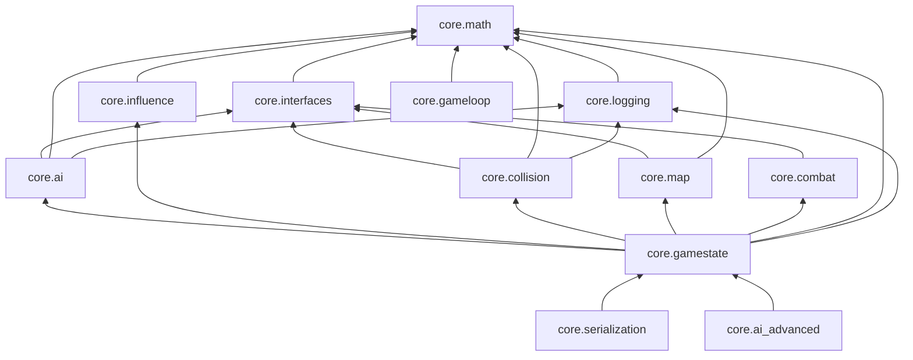

# CoreEngine — Phase 0 Inventory

**Date:** 2025-11-05  
**Repo layout:** `core/` (engine), `platform/` (adapters), `ffi/` (C API), `tests/`, `docs/`  
**Build:** single static target `coreengine` from `CMakeLists.txt` (no per-module CMake targets yet).

---

## 1. Logical modules under `core/`

Modules below match **CMake source globs** and **ARCHITECTURE.md** layers. Subfolders `Behaviors/`, `Conditions/`, and `MapComponents/` are part of their parent module until Phase 2 splits them.

| Module ID | Path | Role | `.cpp` sources (approx.) |
|-----------|------|------|---------------------------|
| `core.math` | `core/math/` | Vectors, constants, deterministic RNG | 1 |
| `core.interfaces` | `core/interfaces/` | Cross-system contracts (`IGameUnit`, `IBehavior`, …) | 0 (headers) |
| `core.logging` | `core/logging/` | `Logger`, levels, integration hooks | 1 |
| `core.ai` | `core/ai/` (+ `Behaviors/`, `Conditions/`) | FSM, `BehaviorFactory`, steering behaviors & transition conditions | 12 |
| `core.influence` | `core/influence/` | APF items, calculator, territory (Voronoi) | 3 |
| `core.collision` | `core/collision/` | Spatial grid, detection, resolution, events, immunity | 10 |
| `core.gameloop` | `core/gameloop/` | Fixed-timestep `GameLogicEngine`, deployment/think timers, playback | 4 |
| `core.map` | `core/map/` (+ `MapComponents/`) | ECS-style map, placement validation | 5 |
| `core.combat` | `core/combat/` | Selection, commands, explosions, combat manager | 4 |
| `core.gamestate` | `core/gamestate/` | `RTSGameState`, `RTSUnit`, state manager | 3 |
| `core.serialization` | `core/serialization/` | Game state serialize/deserialize | 1 |
| `core.ai_advanced` | `core/ai_advanced/` | Bot genomes, genetic trainer (experimental) | 1 |

### Related trees (outside `core/`)

| Area | Path | Relation to `core/` |
|------|------|---------------------|
| **Platform** | `platform/{null,sdl2,raylib,unity,unreal}/` | Implements `core/interfaces` reader/renderer stubs; optional CMake targets `coreengine_sdl2`, `coreengine_raylib` when `BUILD_SDL2` / `BUILD_RAYLIB` ON. No `#include` from `core/` into platform (verified). |
| **FFI** | `ffi/c_api.{h,cpp}` + `ffi/python`, `ffi/lua` | Shared lib `coreengine_ffi` when `BUILD_FFI=ON`; links **private** to monolithic `coreengine`. Public boundary is C types in `c_api.h`. |
| **Tests** | `tests/UnitTests/<Area>/`, `tests/IntegrationTests/` | Single executable `coreengine_tests` when `BUILD_TESTS=ON`; links `coreengine` + GTest. Mirrors core areas (Math, AI, Collision, …). |
| **Docs** | `docs/ARCHITECTURE.md`, guides | Authoritative subsystem descriptions; coding rules in `docs/CODING_GUIDELINES.md`. |

---

## 2. Build and test entry points

### CMake options (`CMakeLists.txt`)

| Option | Default | Output |
|--------|---------|--------|
| (none) | — | Static library `coreengine` |
| `BUILD_FFI` | OFF | Shared `coreengine_ffi` |
| `BUILD_TESTS` | OFF | `coreengine_tests` + `ctest` discovery |
| `BUILD_SDL2` | OFF | `coreengine_sdl2` (needs SDL2) |
| `BUILD_RAYLIB` | OFF | `coreengine_raylib` (needs raylib) |

**Typical CI / local test command** (matches `.gitlab-ci.yml`):

```bash
cmake -S . -B build -G Ninja -DBUILD_TESTS=ON
cmake --build build --parallel
cd build && ctest --output-on-failure
```

**Agentic dependency check** (manifests + Phase 2 `core.math` `#include` enforcement):

```bash
./scripts/check-module-deps.sh
python3 scripts/test_check_module_deps.py
```

**Math-only tests** (Phase 2 pilot):

```bash
./scripts/run-math-module-tests.sh
```

**Influence-only tests** (Phase 2 — does not compile other `core/` `.cpp` files):

```bash
./scripts/run-influence-module-tests.sh
```

### CI

| Pipeline | File | Stages |
|----------|------|--------|
| GitLab (source of truth) | `.gitlab-ci.yml` | `build`: configure with Ninja, `BUILD_TESTS=ON`, build, `ctest` |
| GitHub mirror | *(none in repo yet)* | Relies on GitLab CI or future GitHub Actions |

---

## 3. Coupling hotspots and policy gaps

### Intended layering (from `docs/CODING_GUIDELINES.md`)

- `core/interfaces/` is the **contract** layer; concrete systems should depend on interfaces, not peer concrete types.
- **No platform headers** in `core/` (holds today).

### Observed violations / tight coupling

| Issue | Files | Notes |
|-------|-------|-------|
| **Collision → concrete `RTSUnit`** | `CollisionResolver.cpp`, `CollisionSystem.cpp`, `PositionCorrector.cpp`, `MapCollisionHandler.cpp` | Guidelines say avoid `RTSUnit*` outside gamestate/collision; ideal fix is `IGameUnit` only (Phase 2+). |
| **Combat → `RTSUnit`** | `CommandSystem.cpp` | Same pattern. |
| **Serialization → `RTSGameState`** | `GameStateSerializer.cpp` | Expected for now; may stay in `gamestate` or `serialization` bundle. |
| **Duplicate interface headers** | `core/gamestate/IGameState.h`, `IGameLogicRenderer.h` vs `core/interfaces/` | `GameStateManager` includes local `IGameState.h`; risk of drift from `core/interfaces/`. |
| **Hub module** | `RTSGameState.h` | Pulls combat, map, influence, collision, AI context — natural integration point, hard to edit in isolation. |
| **Interface completeness** | `IBehavior.h` | ~~GCC 13 fails~~ **Fixed:** include complete `InfluenceFieldItem` for `std::vector` in interface (see [BUILD_INTEGRATION.md](BUILD_INTEGRATION.md)). |

### Dependency sketch (allowed direction, target state)



*(Solid arrows = direct `#include` today or expected; collision→gamestate dashed in policy as **to remove**.)*

---

## 4. Test coverage by module

| Module | Unit tests | Integration |
|--------|------------|-------------|
| `core.math` | `DeterministicRNGTest`, `MathConstantsTest`, `Vector2Test` | Used in `DeterminismTest` |
| `core.ai` | `StateMachineTest`, `BehaviorsTest`, `ConditionsTest`, `BehaviorFactoryTest` | `BehaviorRuntimeSwapTest` |
| `core.influence` | `InfluenceFieldTest` | — |
| `core.collision` | `SpatialGridTest`, `ImmunityManagerTest` | — |
| `core.gameloop` | `GameLogicEngineTest`, `DeploymentTimerTest`, `ThinkTimerTest` | — |
| `core.map` | `MapTest` | — |
| `core.combat` | `ExplosionTest` (under `Map/` folder name) | — |
| `core.gamestate` | — | `DeterminismTest` |
| `core.logging` | — | — |
| `core.serialization` | — | — |
| `core.ai_advanced` | — | — |

---

## 5. Phase 2 pilot module recommendation

**Recommended pilot: `core.math` (`core.math` manifest)**

| Criterion | Assessment |
|-----------|------------|
| Clear boundary | Header-heavy; one `.cpp`; no upstream core dependencies |
| Existing tests | Three unit tests + determinism integration |
| High value | Foundation for replay determinism and all spatial/AI systems |
| Low blast radius | Changes rarely ripple through gamestate hub |
| Semver story | Easy to version `1.0.0` and expose `exports` list |

**Runner-up:** `core.influence` — good tests and mostly depends on `math`, but ties to AI behavior field generation.

**Defer:** `core.gamestate` and `core.collision` until interfaces are cleaned (collision↔gamestate coupling).

---

## 6. Local build note (agent environment)

On Ubuntu 24.04 with GCC 13, configure with `CXX=g++` if the default `c++` symlink lacks `libstdc++`. Full `BUILD_TESTS=ON` build and `ctest` are the integration gate — see [BUILD_INTEGRATION.md](BUILD_INTEGRATION.md).